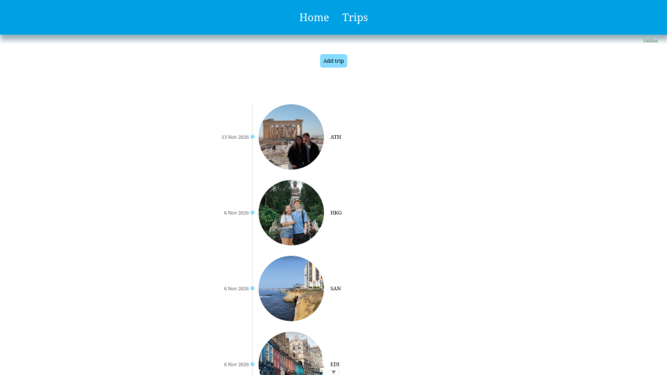
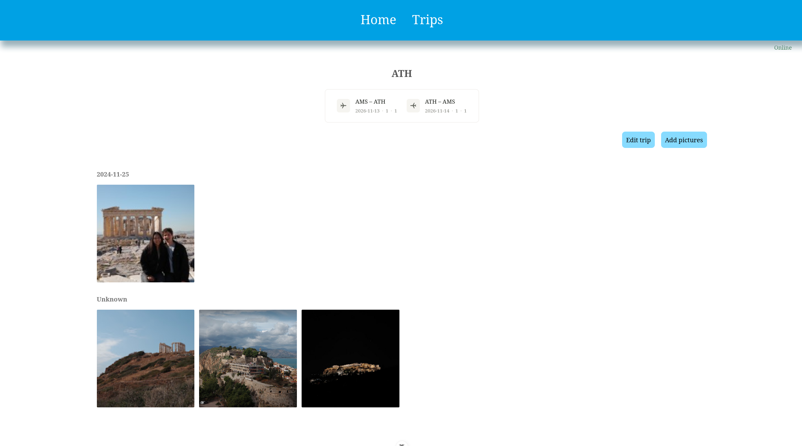
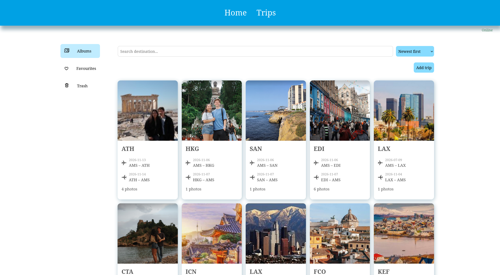
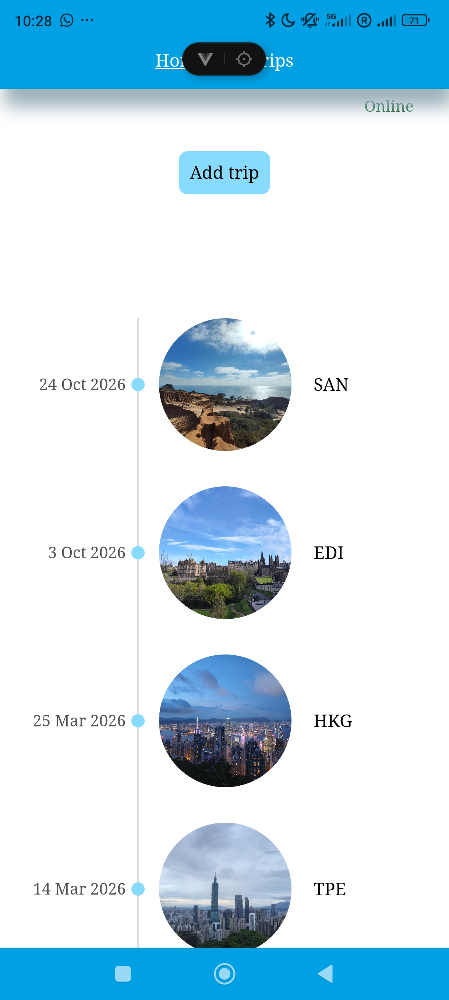
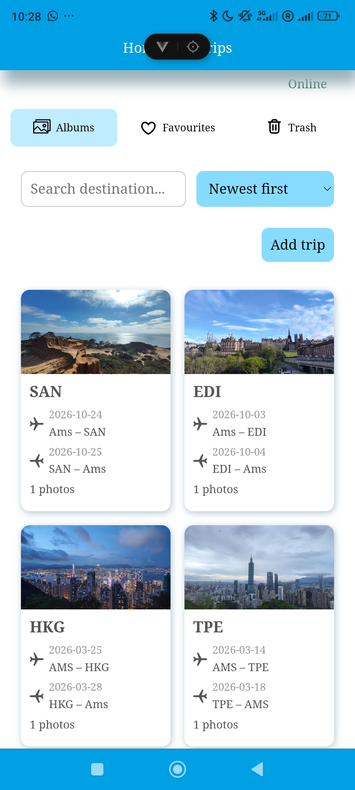
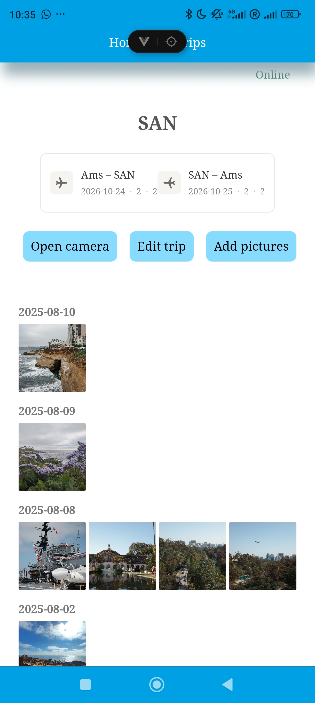

# SkyDiary

A travel photo album application designed to help users organise, browse and relive their travel memories.
SkyDiary was independently developed as a school assignment for a real user (a flight attendant) who wanted a personal app to organise photos that displays information about their trips.

## Screenshots

<details>
<summary> Desktop Screenshots</summary>

### Home & Trips Overview


### Trip Details


</details>

<details>
<summary> Mobiele Screenshots (Responsive)</summary>
<br>
<p align="center">



</p>
</details>

## Features

Home Timeline: A reverse chronological timeline displaying previous trips with dates, destinations, and photos.

Trip Overview: Browse all trips via individual cards with options to search by destination and sort alphabetically or by date.

Trip Albums: View detailed flight info (airports, dates, aircraft), add photos, browse photos grouped by day, and open the device camera directly on mobile.

Photo Management: Add photos to favorites, view them in a dedicated section, move items to the trash, and restore or permanently delete them.

## Built With

Frontend: Vue.js, TypeScript, JavaScript, HTML5, CSS3

Storage: Local Storage

## Project Structure
    
The application is organised into 13 Vue components, multiple composables and views.

This structure helps separate responsibilities and keeps the application organised and maintainable.

## What I Learned
- Applying Vue fundamentals to build a multi-page application.

- Structuring an application using reusable components and composables.

- Working with JavaScript and TypeScript in a Vue application.

- Integrating Progressive Web App (PWA) functionality.

- Managing application state and user interactions.
    
- Working with photo management features: adding photo's and using favourites and trash.

- Saving and retrieving data using local storage.

- Designing responsive interfaces for desktop and mobile devices.

- Developing an application based on the needs of a real user.

## Getting Started

#### Prerequisites
- Node.js
- npm

#### Installation
    
1. Clone the repository:
   ```bash
   git clone https://github.com/Eline304/Sky-Diary.git
   ```
2. Navigate to the project directory:
   ```bash
   cd skydiary
   ```
3. Install the dependencies:
   ```bash
   npm install
   ```
4. Start the local development server:
   ```bash
   npm run dev
   ```
5. Open the local URL displayed in your terminal.

## Development

This project was designed and developed independently, from the initial concept to the implementation of its features.
Sky Diary is currently under development, with additional features and improvements planned.

## Future improvements

1. Automated Flight Data Import via Search
Instead of manually entering all flight details, it would be great to import them automatically using a flight number search (potentially using an API like KLM's).
- The user enters a flight number and date.
- The system fetches and auto-fills the flight data (departure/arrival airports, times, aircraft type, etc.) and displays it on the page before saving.

2. Interactive 2D World Map on Home Page
To give users a better overview of their travels, I suggest adding a 2D world map on the home page, positioned next to the timeline.
- The map should automatically drop pins on all the destinations the user has visited based on their logged flights.

3. Database integration
Switch from local storage to a dedicated database to store trip data and user pictures.
